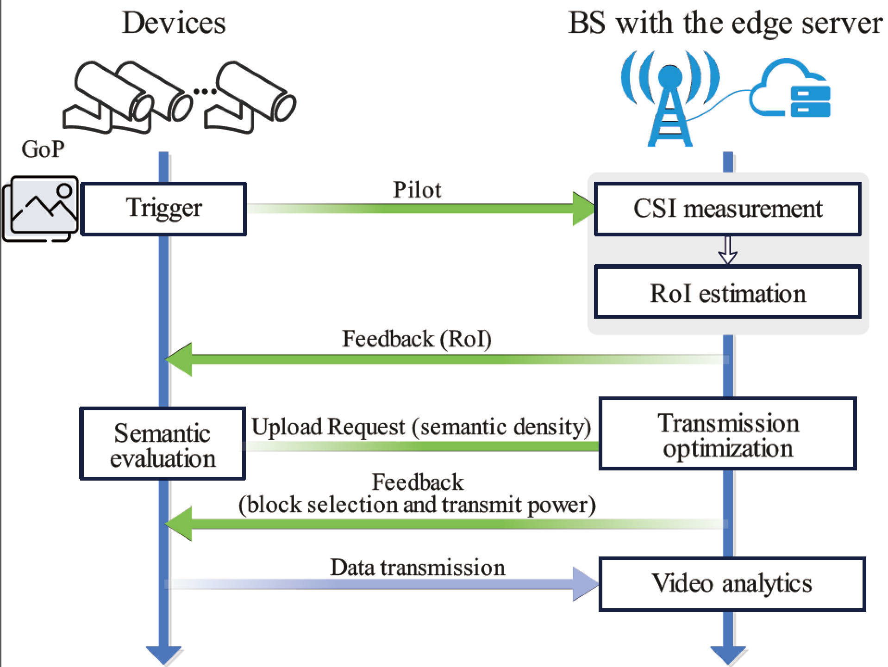

Video analytics plays a vital role in modern applications such as public safety and smart cities, yet transmitting high-resolution video over wireless networks is severely constrained by bandwidth and latency. Existing semantic communication approaches alleviate communication overhead by discarding irrelevant content, but they often impose prohibitive computational costs on resource-constrained surveillance devices. To overcome this limitation, we propose SenSem, a sensing-assisted semantic communication framework that uniquely leverages channel state information (CSI) to reduce both communication and computation overhead. SenSemfirst exploits location cues embedded in CSI to estimate the region of interest and crop frames before upload. On the cropped frames, a lightweight semantic evaluator scores blocks, and a joint block selection and transmit power control algorithm maximizes the analytics performance for multi-device uplink; at the edge, a sensing-assisted analytics network injects spatial cues to further boost inference. Extensive evaluations on the WARP platform demonstrate that SenSemconsistently outperforms state-of-the-art baselines, achieving superior video analytics accuracy under strict latency constraints. By seamlessly reducing both transmission and device-side computation overhead, SenSemoffers a scalable and efficient solution for next-generation wireless video analytics systems.

