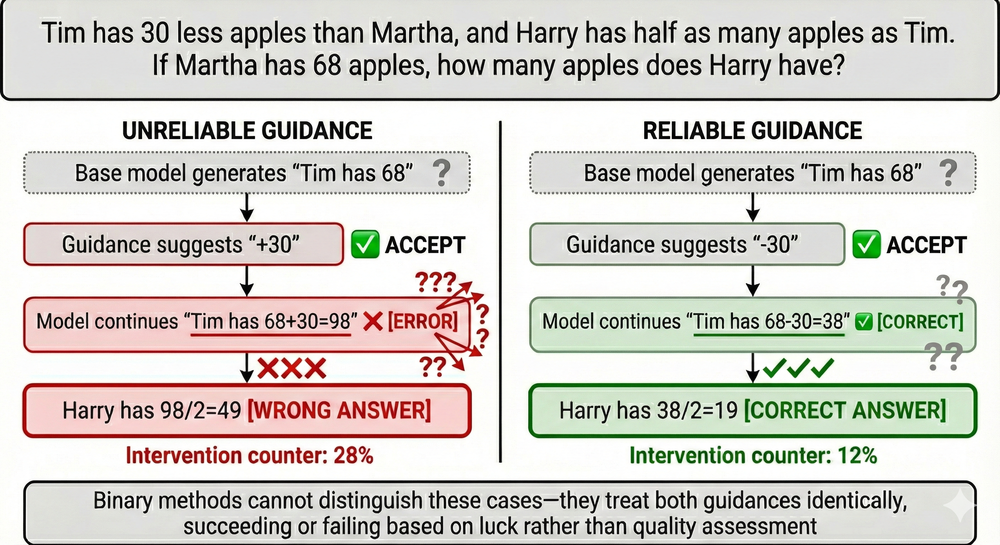

The wide deployment of LLMs has made model alignment necessary to make newly trained models safely and effectively respond to user instructions. Among different methods, inference-time alignment is often cheaper as it intervenes (i.e., offers guidances) only during output generation. Existing proposals apply guidances extracted from certain aligned models without properly assessing their reliability. Nonetheless, our systematic evaluation reveals that guidance effectiveness varies drastically across models; since ineffective guidances lead to further confusion and thus further interventions, the resulting excessive interventions typically indicate poor performance. To make interventions more effective and thus more efficient, we introduce BlendIn, an inference-time alignment framework that shifts from binary decisions to creating hybrid distributions integrating both models’ knowledge. BlendIn stabilizes inference-time alignment by performing quality-aware alignment and proportionally weighting each model’s contribution based on reliability. Compared with existing works, it preserves beneficial guidance while downweighting unreliable suggestions. BlendIn provides both diagnostic signals and mitigation strategies for misaligned guidance, achieving consistent and up to 50% performance improvement on challenging model pairs.

