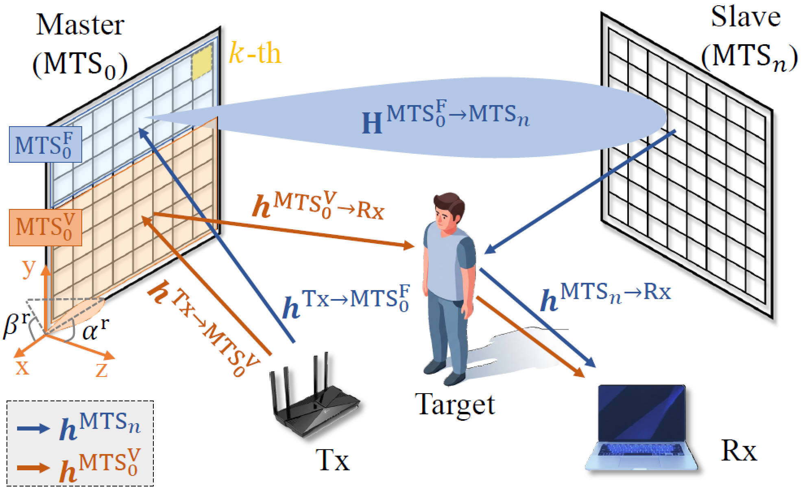

Wi-Fi has emerged as a promising medium for device-free human sensing, yet its capability in fine-grained sensing tasks remains rather limited. In particular, existing solutions to human pose estimation (HPE) demand extensive hardware elevations (e.g., multiple antennas or transceivers) directly upon Wi-Fi home deployments, typically involving very few APs and clients. In this paper, we present MetaVision, a system that utilizes programmable metasurfaces as external add-on to create multiple virtual viewpoints, thus substantially extending the spatial diversity of a single pair of AP and client. MetaVision organizes its metasurfaces into a master-slave hierarchy to tackle inter-surfaces synchronization. It further separates individual signals from these homogeneous metasurfaces, exploiting a novel temporal encoding scheme that effectively decouples superimposed signals into independent signal spectrograms. Fusing these multi-view spectral representations, MetaVision employs a neural network to model inter-joint dependencies and to accordingly reconstruct 3D human poses. Extensive experiments demonstrate that MetaVision achieves high-resolution 3D HPE and reduces error by 61% compared with baseline approaches.

