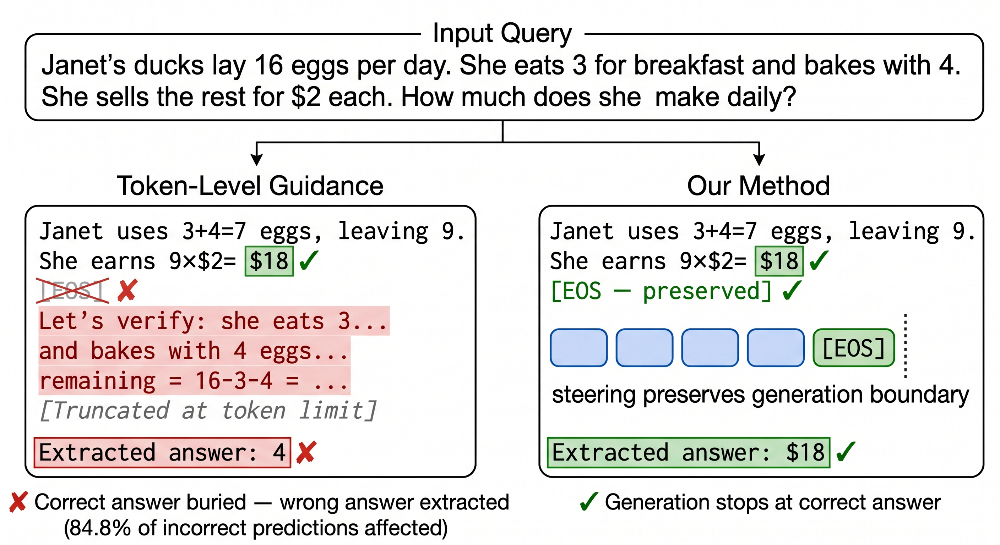

Large language models (LLMs) finetuned for specialized domains represent crucial high-impact applications. Inference-time alignment improves safety degraded from specialization finetuning without requiring substantial computational resources, complementing finetuning-based methods with an easy-to-use, plug-and-play solution. However, existing inference-time methods fail to reliably improve safety without disrupting domain capability. We identify the root cause as complementary expertise orthogonality: specialized base models and general-domain guidance models have orthogonal competencies, making the guidance signal unreliable for specialized generation. This primarily manifests as stop token interference, where the guidance model’s tendency toward continuation overrides the base model’s decision to stop, burying correct answers under guidance-induced continuation. To address this problem, we propose CREST, an inference-time alignment method that steers base model hidden representations using safety directions extracted from a guidance model of any family, avoiding token-level structural limitations entirely. CREST improves safety where specialization has weakened it while preserving both domain-specific capability and the safety of already well-aligned models, outperforming baselines by up to 22.2% on safety benchmarks.

